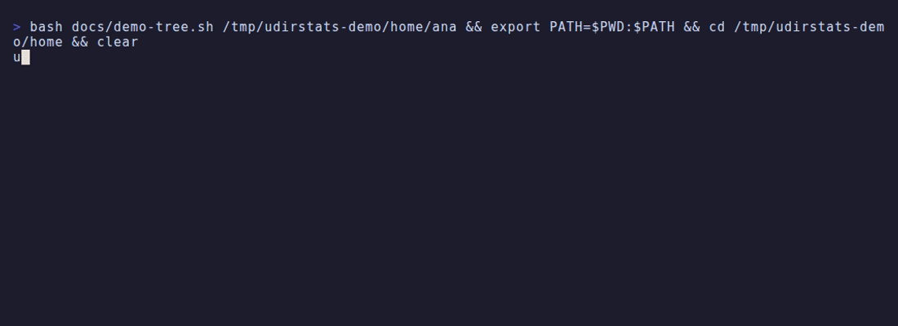

# udirstats

Analisador de uso de disco para o terminal, inspirado no WinDirStat/ncdu: varre um diretório
e mostra pastas e arquivos ordenados por tamanho, com navegação entre as pastas.



## Instalação

Os binários de cada versão ficam em [Releases](https://github.com/vluzrmos/udirstats/releases)
(Linux e Windows em amd64/arm64). Os comandos abaixo baixam a versão mais recente.

### Linux

Com `curl`:

```bash
ARCH=$(uname -m | sed 's/x86_64/amd64/; s/aarch64/arm64/')
curl -fsSL "https://github.com/vluzrmos/udirstats/releases/latest/download/udirstats-linux-$ARCH.tar.gz" \
  | tar -xz -C /tmp udirstats
install -Dm755 /tmp/udirstats ~/.local/bin/udirstats
```

Com `wget`:

```bash
ARCH=$(uname -m | sed 's/x86_64/amd64/; s/aarch64/arm64/')
wget -qO- "https://github.com/vluzrmos/udirstats/releases/latest/download/udirstats-linux-$ARCH.tar.gz" \
  | tar -xz -C /tmp udirstats
install -Dm755 /tmp/udirstats ~/.local/bin/udirstats
```

Garanta que `~/.local/bin` está no `PATH`; para instalar para todos os usuários, troque o destino
por `/usr/local/bin` e rode o `install` com `sudo`.

### Windows

No PowerShell (instala em `%LOCALAPPDATA%\Programs\udirstats` e adiciona ao `PATH` do usuário):

```powershell
$arch = if ($env:PROCESSOR_ARCHITECTURE -eq 'ARM64') { 'arm64' } else { 'amd64' }
$dir  = "$env:LOCALAPPDATA\Programs\udirstats"
$zip  = "$env:TEMP\udirstats.zip"
Invoke-WebRequest "https://github.com/vluzrmos/udirstats/releases/latest/download/udirstats-windows-$arch.zip" -OutFile $zip
Expand-Archive $zip -DestinationPath $dir -Force
Remove-Item $zip
$path = [Environment]::GetEnvironmentVariable('Path', 'User')
if ($path -notlike "*$dir*") { [Environment]::SetEnvironmentVariable('Path', "$path;$dir", 'User') }
```

Abra um novo terminal e rode `udirstats`. O Windows 10/11 também traz `curl.exe` e `tar.exe`,
então dá para baixar e extrair sem PowerShell:

```bat
curl -fLo udirstats.zip https://github.com/vluzrmos/udirstats/releases/latest/download/udirstats-windows-amd64.zip
tar -xf udirstats.zip udirstats.exe
```

## Build

```bash
make build      # binário estático ./udirstats
make install    # copia para ~/.local/bin
make test
```

## Uso

```bash
udirstats [-x] [-apparent] [caminho]
```

- `-x` — não cruza para outros filesystems (no WSL, ignora `/mnt/c` etc.; também pula `/proc`, `/sys`).

No Windows, o uso em disco é estimado pelo tamanho do cluster do volume (considerando arquivos
comprimidos e esparsos); hardlinks não são deduplicados e `-x` não tem efeito.
- `-apparent` — começa exibindo o tamanho aparente em vez do uso em disco.

| Tecla | Ação |
|---|---|
| `↑` `↓` / `j` `k` | mover |
| `PgUp` `PgDn` / `Home` `End` | paginar / início e fim |
| `Enter` `→` `l` | entrar na pasta |
| `Backspace` `←` `h` `Esc` | voltar |
| `s` | alternar ordenação: tamanho, nome, nº de arquivos |
| `a` | alternar uso em disco / tamanho aparente |
| `r` | reescanear a pasta atual |
| `q` | sair |

## Cores

- A barra e o tamanho usam um degradê verde → amarelo → laranja → vermelho relativo ao maior
  item da pasta; a coluna `%` é relativa à pasta atual.
- Arquivos são coloridos por tipo (imagem, vídeo, áudio, compactado, código, documento,
  binário, config); symlinks aparecem em itálico com `→`.
- Funciona em true color, 256 e 16 cores (detectado pelo terminal, cada cor fixa tem valor
  explícito para cada nível), em fundo claro ou escuro, e respeita `NO_COLOR`.

Itens marcados com `!` tiveram erro de leitura (normalmente permissão); o erro aparece na
linha de status quando o item é selecionado. Symlinks não são seguidos e hardlinks são
contados uma única vez.
